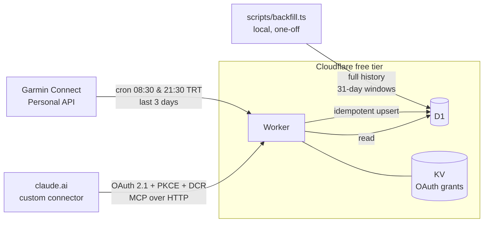

# garmin-mcp

A single-user, read-only bridge from the **official Garmin Connect Personal API** to Claude.
A Cloudflare Worker pulls sleep, HRV, daily wellness and activities twice a day into D1, keeps the
full history, and serves it as a remote **MCP server** that claude.ai uses as a custom connector, behind OAuth 2.1.

It replaces a manual routine (a screenshot of the sleep screen every morning) and feeds a training-coach
Project and its scheduled tasks in claude.ai.



## Design decisions

| Decision                                                                               | Why                                                                                                                                                                                                                                                                                        |
| -------------------------------------------------------------------------------------- | ------------------------------------------------------------------------------------------------------------------------------------------------------------------------------------------------------------------------------------------------------------------------------------------ |
| Official Personal API only (no `garth` / `python-garminconnect`)                       | Those log in with e-mail + password through Garmin SSO and break whenever SSO changes. The Personal API is a documented, key-based, read-only contract.                                                                                                                                    |
| Own store in D1, with read-through for recent days only                                | Long-term trends independent of Garmin's windows and fast answers. A question about a recent day that is not stored yet (e.g. last night before the morning cron) fetches it from Garmin once; a 10-minute cooldown keeps an unsynced watch from turning every question into Garmin calls. |
| Cron twice a day (08:30, 21:30), re-pulling the last 3 days                            | The morning run catches most nights; read-through covers a watch that syncs later. The evening run and the 3-day overlap catch late syncs and edited activities. Upserts make re-runs safe.                                                                                                |
| Backfill as a local script sharing the Worker's code                                   | Full history is ~1,000 days × several endpoints, far beyond a Worker's 50 subrequests per invocation on the free plan. `fetchWindow()` and the mappers are the same code in both paths.                                                                                                    |
| No FIT parsing in the Worker                                                           | Decoding one run's FIT takes 50–70 ms CPU; the free plan allows 10 ms. The JSON activity list already has averages, running dynamics, HR zones, splits and exercise sets. Per-second streams are a paid-plan upgrade (see Next steps).                                                     |
| One table per Garmin source, joined at read time                                       | Each table has one owner endpoint and one grain (night, day, activity), so a schema change at Garmin touches one mapper.                                                                                                                                                                   |
| `NULL`, never `0`, for missing values                                                  | Garmin omits null fields. A fake 0 would read as "zero REM" to a coach. Every tool says which fields are derived (`computed`).                                                                                                                                                             |
| Night dated by wake-up day                                                             | Matches Garmin and the way the question is asked: "last night" is today's date.                                                                                                                                                                                                            |
| OAuth 2.1 via `@cloudflare/workers-oauth-provider`, owner password on the consent page | claude.ai custom connectors need OAuth with PKCE and dynamic client registration. The data is health data, so the URL alone must never be enough. Tokens are stored hashed in KV.                                                                                                          |

Full API research, field mapping and validation against a hand-kept log: [docs/api-findings.md](docs/api-findings.md).

## MCP tools

| Tool                                                      | Returns                                                                                                                                                                                                                                                                                                                                                                                                |
| --------------------------------------------------------- | ------------------------------------------------------------------------------------------------------------------------------------------------------------------------------------------------------------------------------------------------------------------------------------------------------------------------------------------------------------------------------------------------------ |
| `get_sleep(start_date?, end_date?)`                       | Per night: score + qualifier, total/deep/light/REM/awake, awake count, restlessness qualifier, overnight HRV + 7-day avg + status, resting HR, Body Battery gained in sleep. Defaults to last night. Missing recent nights are fetched on demand; every missing day comes back in `missing` with a reason (`not_synced_yet`, `no_data_at_garmin`, `garmin_unavailable`, `future_date`) and a `notice`. |
| `get_daily_wellness(start_date?, end_date?)`              | Per day: resting HR (+7-day avg), Body Battery min/max/charged/drained, stress, steps. Same read-through and `missing` / `notice` as `get_sleep`.                                                                                                                                                                                                                                                      |
| `list_activities(start_date?, end_date?, activity_type?)` | Activities with user description, distance, duration, HR, load. Defaults to the last 7 days.                                                                                                                                                                                                                                                                                                           |
| `get_activity(activity_id)`                               | Full summary: HR zones, cadence, running dynamics, power, training effect, split summaries, exercise sets.                                                                                                                                                                                                                                                                                             |
| `get_sync_status()`                                       | Today in Europe/Istanbul, last sync runs, stored date coverage.                                                                                                                                                                                                                                                                                                                                        |
| `refresh_activity(activity_id)`                           | Re-pulls one activity from Garmin and overwrites the stored copy (for a note added or edited later). The only tool that calls Garmin; 3 requests. Also `node scripts/refresh-activity.ts <id>` from a shell.                                                                                                                                                                                           |

## Project layout

```
src/
  index.ts            entry: OAuth provider, /mcp handler, scheduled()
  garmin/             API client (token exchange, retries, Retry-After) and DTO types
  sync/               fetchWindow() (shared with backfill), DTO -> row mappers, cron job
  db/                 row types, parameterised upserts, read queries
  mcp/                tool definitions and output shaping
  auth/               /authorize consent page (owner password)
  shared/             dates (Istanbul calendar), structured logging
migrations/           D1 schema
scripts/              backfill.ts, Phase 0 probes, OAuth smoke test
docs/                 api-findings.md (Phase 0 API research)
test/                 vitest unit tests
```

## Setup

Requirements: Node ≥ 23 (runs `.ts` scripts natively), a Cloudflare account, a Garmin Connect account.

1. **Install**
   ```bash
   npm install
   npx wrangler login
   ```
2. **Garmin key**: create one at connect.garmin.com/app/settings/personalApiToken (pick 1 year).
   Copy `.dev.vars.example` to `.dev.vars` and fill in `GARMIN_API_KEY`. The file is gitignored.
3. **Cloudflare resources**
   ```bash
   npx wrangler d1 create garmin
   npx wrangler kv namespace create OAUTH_KV
   ```
   Put the printed ids into `wrangler.jsonc`, and set `PUBLIC_ORIGIN` to
   `https://garmin-mcp.<your-subdomain>.workers.dev` (register the workers.dev subdomain once in the dashboard).
4. **Schema and secrets**
   ```bash
   npm run db:migrate
   npx wrangler secret put GARMIN_API_KEY
   npx wrangler secret put OWNER_PASSWORD
   ```
   `OWNER_PASSWORD` must be at least 16 characters; it is asked on the consent page.
5. **Deploy and backfill**
   ```bash
   npm run deploy
   npm run backfill
   ```
   The backfill walks back from yesterday in 31-day windows until it finds three empty windows.
6. **Connect claude.ai**: Settings → Connectors → Add custom connector → URL `<PUBLIC_ORIGIN>/mcp`.
   Sign in with the owner password on the consent page.

## Development

```bash
npm test             # unit tests
npm run typecheck
npm run lint
npx wrangler dev --var PUBLIC_ORIGIN:http://localhost:8787 --var OWNER_PASSWORD:<16+ chars> --test-scheduled
curl "http://localhost:8787/__scheduled?cron=30+7+*+*+*"          # run the sync once
node scripts/oauth-smoke.mjs http://localhost:8787 <password>    # DCR -> PKCE -> token -> tools/list
```

Phase 0 probes (`scripts/probe.mjs`, `history-probe.mjs`, `rate-probe.mjs`, `fit-probe.mjs`) write raw
responses to `probe-output/`, which is gitignored because it holds personal health data.

## Operations

- **Logs**: Workers Logs (observability enabled), structured JSON. Tokens and health values are never logged.
- **Sync history**: `get_sync_status`, or `npx wrangler d1 execute garmin --remote --command "SELECT * FROM sync_runs ORDER BY started_at DESC LIMIT 5"`.
  `trigger` is `cron 30 5 * * *` / `cron 30 18 * * *` for scheduled runs, `backfill` for the history import,
  `manual` for single-activity refreshes (`counts_json.source` is `mcp` or `script`), and `on_demand` for read-through
  fetches (`counts_json.source` is the tool name).
- **Key rotation**: Garmin keys expire (max 1 year; Garmin e-mails a week before). Create a new key, then run
  `npx wrangler secret put GARMIN_API_KEY` and update `.dev.vars`.

## Known limits

- **Restlessness** has no number in the API, only a qualifier (`FAIR`); the app's "restless moments" count is not exposed.
- **Activity descriptions** only exist if they are written in Garmin Connect. Strava notes do not flow back.
  The cron re-reads 3 days; for an older activity, ask Claude to run `refresh_activity`.
- **Strength sets** (exercise, reps, weight) appear only for sessions recorded with the watch's Strength profile; HIIT sessions give rounds and durations.
- **Rate limit** of ~100 requests/minute (undocumented, measured).

## Next steps

- BigQuery export from D1 for long-term analysis alongside other training data.
- Per-second streams and laps from FIT files (needs the Workers Paid plan for CPU, or a queue consumer).
- Sending workouts to Garmin (out of scope: the Personal API is read-only).
- A small trends dashboard.
